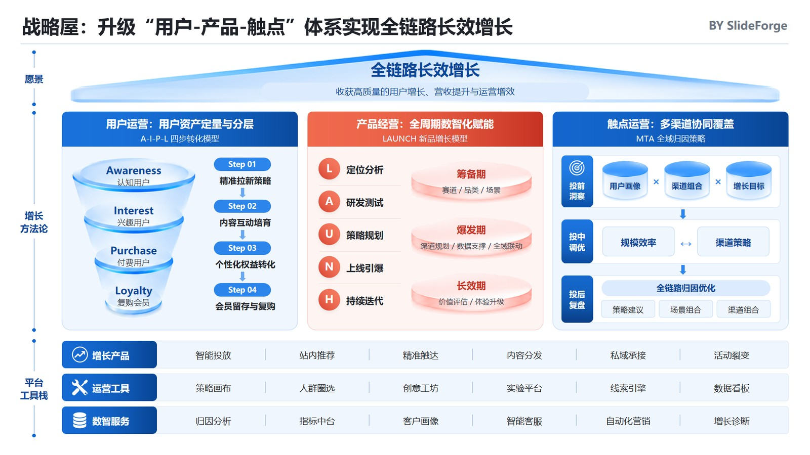
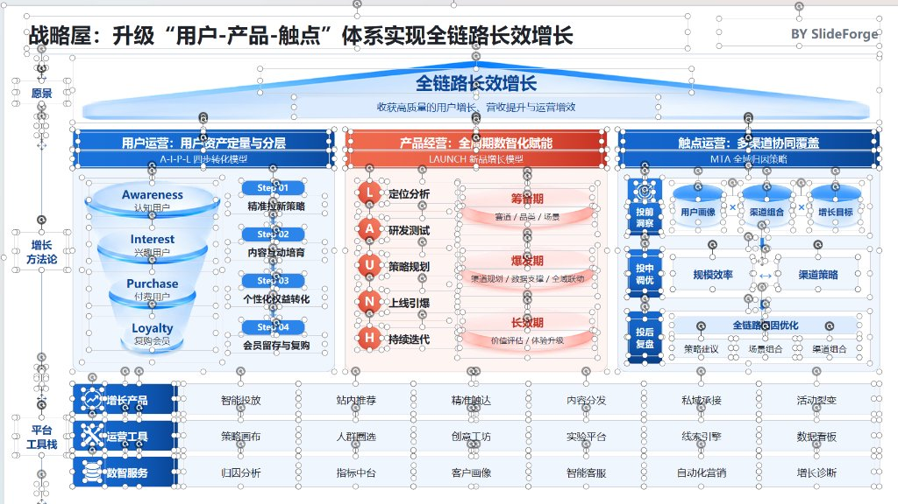
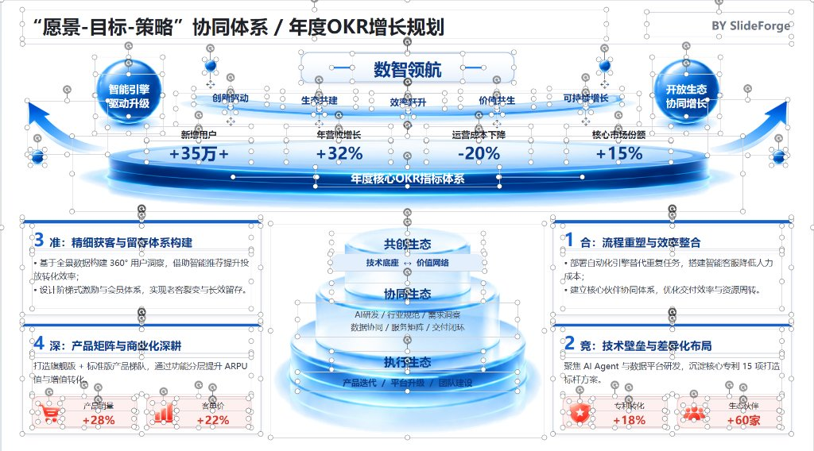
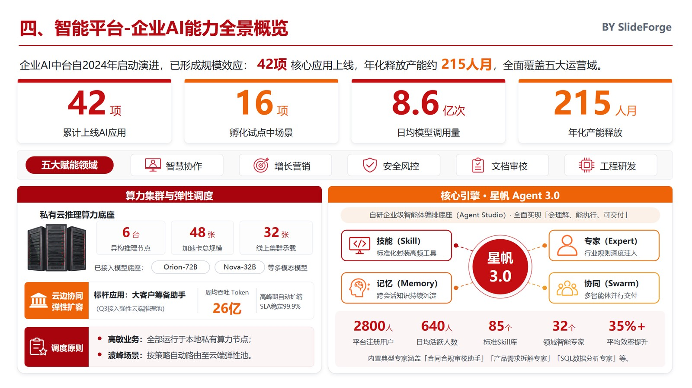
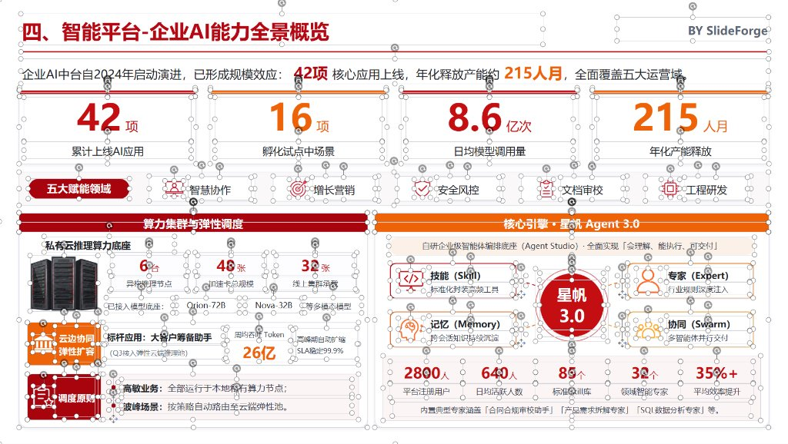
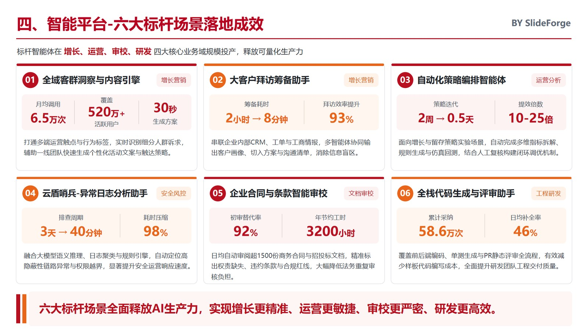
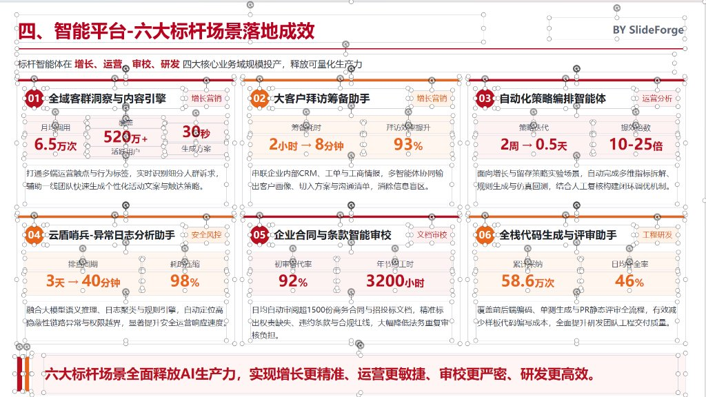
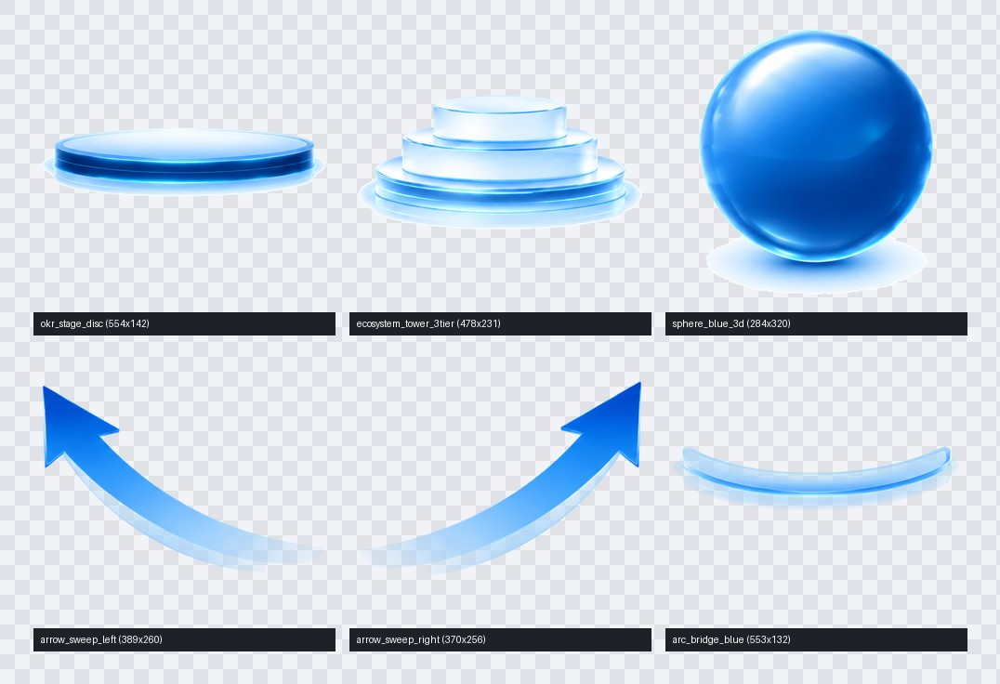

# SlideForge

<p align="center">
  <a href="README.md">English</a>
</p>

<h1 align="center">SlideForge</h1>

<p align="center">
  <b>输入文档或扁平图，交付原生可编辑 PPTX。</b><br />
  面向 Coding Agent 的混合式幻灯片生产技能：纯白底多批次 AI 组件图集 × OOXML 原生矢量分层装配 × PowerPoint/LibreOffice 实渲自检。
</p>

<p align="center">
  <a href="LICENSE"></a>
  
  
  
  <a href="SKILL.md"></a>
</p>

<p align="center">
  <a href="#zh-comparisons">效果对比</a> ·
  <a href="#zh-features">核心特性</a> ·
  <a href="#zh-architecture">架构</a> ·
  <a href="#zh-quick-start">快速开始</a> ·
  <a href="#zh-agent-workflow">Agent 使用</a> ·
  <a href="#zh-contributing">参与贡献</a> ·
  <a href="#zh-links">相关链接</a>
</p>

---

<a id="zh-comparisons"></a>

## 实拍效果：PowerPoint `Ctrl+A` 全选可编辑证明

以下 4 套示例全部采用脱敏模拟数据。左侧为生成的 `.pptx` 真实渲染效果，右侧为同一份 `.pptx` 在 PowerPoint 中直接按下 **`Ctrl+A` 全选** 的真实截图——每一处文字、渐变色块、边框、连接线与透明立体组件均为独立的原生可编辑对象，绝非死图片。

| 生成结果（PowerPoint 实渲） | PowerPoint 中按 `Ctrl+A` 全选（全原生可编辑） |
| :---: | :---: |
|  |  |
|  |  |
|  |  |
|  |  |

### 纯白底组件图集自动抠透明验收（棋盘格预览）

<p align="center">
  
</p>

<a id="zh-features"></a>

## 核心特性

### 正向分层重建，而非逆向 OCR 擦字

传统的“图片转 PPT”依赖 OCR 识字、局部涂抹擦除和暴力抠图，往往导致背景发花、图标带白边、卡片变成不可调色的位图。SlideForge 按 4 个职责清晰解耦，正向重建整页：

- **Layer 1 · 用户背景底板层**：原样保留用户提供的企业背景图（自带 Logo、页眉、页脚或装饰纹样），不做任何破坏性裁切；无背景图时直接在纯净画布上构建。
- **Layer 2 · 原生 OOXML 矢量层**：卡片、虚线 Bento 容器、线性渐变色块、精确百分比圆环、漏斗/金字塔、表格与连接线均由原生 PowerPoint 形状构建，可自由拖拽缩放与改色。
- **Layer 3 · 独立透明 AI 组件层**：仅将代码不便绘制的定制图标、徽章、立体图示、丝缎渐隐箭头交由 OpenAI 兼容生图模型在纯白 `#FFFFFF` 底上生成，再提取为干净的 RGBA 透明 PNG。
- **Layer 4 · 可编辑排版层**：所有文本强制写入 `<a:ea>`、`<a:latin>`、`<a:cs>` 字体节点，避免中文在 PowerPoint/WPS 中退化成宋体。

### 多批次组件图集与跨批画风锁定

单张生图强塞超过 10 个组件会导致细节糊化与边缘粘连。`generate_components.py` 将单批上限严格控制在 `<= 8` 枚图标（`2×4`）或 `<= 4–6` 枚大型组件（`2×2` / `2×3`），超量自动拆分多批调用，并跨批次绑定同一 `style_ref` 与 `palette_lock`（可选 `chain_batch1` 链式锚定），保证整页线宽、圆角与色阶一致。

### 双模式透明抠图与棋盘格验收

`extract_components.py` 通过行列投影谷底自动切分网格，提供两种透明通道算法：

- `solid`：外围 BFS 泛洪抠白 + 1px 外缘去白边，保护深色徽章内部的纯白图标不被误抠。
- `soft_fade`：白底反混色提取（`C = αF + (1 - α)255`），完整保留渐隐箭头与丝缎柱图的半透明渐变尾迹。

同时自动清理孤立噪点、支持派生单色变体（如 `"tint": "white"` 用于深色底面），并输出棋盘格验图 `*_alpha_preview.png` 供装配前人工或 Agent 核验。

### 双工作模式按需切换

| 模式 | 输入 | 执行路径 | 适用场景 |
| :--- | :--- | :--- | :--- |
| **模式 A · 极速直出** | 文档/大纲 + 可选背景图 | 跳过整页参考图 → 规划版式 → 生成组件图集 → 代码直出 PPTX → 实渲自检 | 日常汇报、架构图、流程与指标页，省时省成本 |
| **模式 B · 蓝图复刻** | 已有成品图，或先出整页蓝图 | 以整页图为 `style_ref` → 拆批提取透明组件 → 4 层 1:1 原生复刻 → 实渲精修 | 高管汇报、去方框杂志风排版、把现有 AI 扁平图还原为真 PPT |

### 真实 PowerPoint / WPS / LibreOffice 渲染闭环

`render_pptx.py` 将生成的 `.pptx` 重新渲染为 1080p PNG，供 Agent 逐页核查断行溢出、对齐偏差与留白比例。Windows 下通过原生 PowerShell COM 调用本机 PowerPoint 或 WPS（零 `pywin32` 依赖，内置跨进程文件互斥锁支持多 Agent 并行渲染）；macOS/Linux 自动回退至 LibreOffice + PyMuPDF。

<a id="zh-architecture"></a>

## 架构

```text
brief.md / target_slide.png (+ 可选 template_bg.png)
                        |
                        v
             Agent 版式规划与组件清单
            (components_manifest.json)
                        |
                        v
      generate_components.py（多批次纯白底 #FFFFFF、零文字）
                        |
                        v
      extract_components.py（BFS / soft_fade -> RGBA PNG + 棋盘格验图）
                        |
                        v
      build_deck.py / build_slide.py（pptx_kit.py 四层 OOXML 装配）
                        |
                        v
      render_pptx.py（PowerPoint/WPS COM 互斥锁 或 LibreOffice -> PNG 验收）
                        |
                        v
               output_editable.pptx
```

### `pptx_kit.py` 内置解决的典型底层问题

- **中文字体回退**：为每个 run 同时写入 `<a:latin>`、`<a:ea>`、`<a:cs>`。
- **默认主题重阴影**：为扁平图形显式写入空 `<a:effectLst/>`，仅对需要层次的卡片施加克制微影。
- **`BLOCK_ARC` 角度乘数坑**：`add_donut_ring()` 内置 `deg * 0.6` 换算，修正 OOXML `1/60000` 度与 `python-pptx` `100000` 调整值倍率差异。
- **原生表格样式清理**：移除默认蓝白斑马纹样式 ID，输出极细横线咨询表格。

<a id="zh-quick-start"></a>

## 快速开始

### 环境要求

- Python `>= 3.10`（推荐配合 [`uv`](https://docs.astral.sh/uv/) 运行）
- 任意 OpenAI 兼容生图接口 Key（支持 `gpt-image-1`、`gpt-image-2.6` 等模型）
- 渲染验收环境：Windows 本机安装 PowerPoint 或 WPS；macOS / Linux 安装 LibreOffice 与 `pymupdf`

### 安装与配置

```bash
git clone https://github.com/123zhaozheng/SlideForge.git
cd SlideForge
cp .env.example .env
# 在 .env 中填入你的 OPENAI_API_KEY 与 OPENAI_BASE_URL
```

Windows（PowerShell）：

```powershell
.\install.ps1
```

macOS / Linux：

```bash
chmod +x install.sh && ./install.sh
```

### 本地干跑校验（不消耗 API）

```bash
uv run --with requests --with pillow --with python-dotenv \
  python scripts/generate_components.py \
  --session ./outputs/demo \
  --manifest examples/components_manifest.sample.json \
  --dry-run
```

<a id="zh-agent-workflow"></a>

## Agent 使用

SlideForge 以标准 Agent Skill（[`SKILL.md`](SKILL.md)）形式组织，可直接配合 Claude Code、Cursor、Codex、Antigravity 等 Agent 使用。

1. 将本仓库放入你的 Agent 技能目录，或在对话中直接指向 `SlideForge/SKILL.md`。
2. 给出参考图、文档或背景底板即可触发：
   - **模式 B（扁平图复刻）**：
     > 请阅读 `SlideForge/SKILL.md`，将 `target_slide.png` 复刻为 100% 原生可编辑的 PPTX，并用 `render_pptx.py` 渲染验收。
   - **模式 A（文档直出）**：
     > 请阅读 `SlideForge/SKILL.md`（模式 A），基于 `brief.md` 与背景图 `template_bg.png` 生成 8 页可编辑 PPTX。
3. 长文档支持多 Agent 并行：每页在独立目录 `slides/slide_XX/build_slide.py` 中导出 `build_slide(prs)` 并完成单页实渲，最后一键合并为完整演示文稿。

### 人与 Agent 的分工

| 人 | Agent |
| :--- | :--- |
| 提供文档、品牌背景图（可选）或参考成图 | 拆解原生矢量结构与 AI 透明组件清单 |
| 选择模式 A（直出）或模式 B（蓝图复刻） | 调起多批次组件生成并核验棋盘格抠图 |
| 在 PowerPoint 中按需微调终稿文案 | 编写 OOXML 装配脚本、实渲回看并修正对齐溢出 |

<a id="zh-contributing"></a>

## 参与贡献

```bash
# 语法校验与冒烟测试
uv run --with requests --with pillow --with numpy --with python-pptx --with python-dotenv \
  python -m py_compile scripts/*.py
```

提交 PR 请保持 `pptx_kit.py` 的底层质量约束（显式东亚字体、清除默认重影、等比置图），且不在公共脚本中硬编码任何特定品牌或路径。详见 [CONTRIBUTING.md](CONTRIBUTING.md) 与 [SECURITY.md](SECURITY.md)。

<a id="zh-links"></a>

## 相关链接

- [GitHub 仓库](https://github.com/123zhaozheng/SlideForge)
- [Agent 技能规范](SKILL.md)
- [组件拆解与分批规范](references/component-splitting.md)
- [设计体系与配色法则](references/design-systems.md)
- [十大版式原型库](references/layout-archetypes.md)
- [python-pptx 避坑手册](references/pptx-pitfalls.md)
- [LINUX DO - 社区讨论](https://linux.do/)
- [问题反馈](https://github.com/123zhaozheng/SlideForge/issues)

## 开源协议

本项目基于 [MIT License](LICENSE) 开源。第三方企业模板、字体与用户提供的图片素材仍遵循其原有许可协议。
